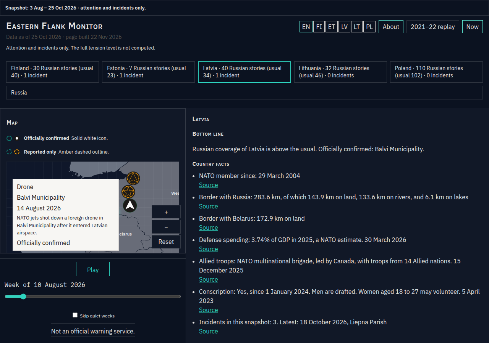
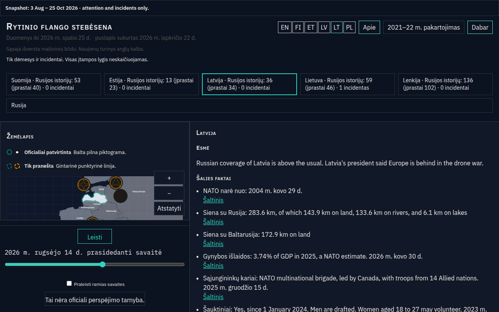

# Eastern Flank Monitor

A briefing room for military tension on NATO's eastern flank — watching Russia's side.

## What it is

A local prototype. It reads public Russian coverage of Finland, Estonia, Latvia, Lithuania, and Poland, and shows a calm picture. It does not collect or display Finnish, Baltic, Polish, or NATO force locations.

Two modes:

1. Replay. Stored weeks from 4 January 2021 through 28 February 2022. No hindsight. No API calls.
2. Now. A frozen snapshot, 3 August through 25 October 2026. Attention and incidents only. The full tension level is not computed for Now.

It is not an official warning service. It is not a live siren. In a crisis, follow your national authorities.

Live monitoring is off. Demo mode makes no API calls.

## Features

1. Six country tabs: Finland, Estonia, Latvia, Lithuania, Poland, Russia. One tab is always selected.
2. A fixed briefing, in this order: bottom line, what happened, what officials said, what Russian media says, what regional media says.
3. Official items carry a side label: Russian official, or regional or Western official.
4. A repeated story is one item. The line lists every outlet.
5. A country fact card. Each fact has a dated source link. A fact with no dated page is left out.
6. The Russia tab: Inside Russia, the ruble and the key rate, a Russia fact card, and a Levada poll. Now shows the 16 June 2026 release. Replay keeps the 2021 poll.
7. An incident map. The outlines are Natural Earth, public domain, stored in the project. Confirmed is a solid white icon on a dark circle. Reported is an amber dashed outline. Hover or tap shows one card. A click opens the same item in the briefing. Icons stay the same size when you zoom. The map shows the selected week and the four weeks before it.
8. English is the source language. A Russian line is shown only with an English line. The English line is first.
9. The interface is in six languages: English, Finnish, Estonian, Latvian, Lithuanian, and Polish.
10. An About panel. Method notes live there, not in the briefing.

## How it works

Four layers, from SPEC.md:

1. Capability. Can Russia do it?
2. Intent. Are they preparing the story?
3. Opportunity. Is the window open?
4. Hybrid. How hot is the grey zone?

The two-witness rule is the main guard against a false alarm. The overall level stays at Watchful until two or more layers are Elevated at the same time. Hybrid alone, or Opportunity alone, cannot raise it. An empty layer is not a second witness. It is also not zero. Serious and Critical need a human confirmation before they are shown as those levels. Unconfirmed, they stay Elevated, with the proposal named.

A row counts for a week only if its source date is on or before the last day of that week.

The comparisons used on the About page, and only those, are in `docs/explainers.md`. The app is a weather station, not a siren. The backtest is a smoke detector: Ukraine is the fire, the eastern flank is burnt toast. One witness is not enough. Silence is not calm.

## Results, told straight

The rules were written down before the scoring run. The stored week table was not rewritten after the result.

Test A passed, on a lenient bar. The bar asked only whether Ukraine's shown level reached Elevated before 24 February 2022. It did, on the week of 19 April 2021. It did not ask for a confirmed Serious or Critical alarm. No Serious or Critical level was confirmed. Details: `docs/backtest-report.md`.

Test B failed by the sealed rules. On the week of 7 February 2022 the eastern flank proposed Serious. Intent was 2. Capability was 2. Opportunity was 1.5, and the registered rule rounded 1.5 to 2. Three layers at Elevated made the proposal Serious. It was shown as Elevated, with the proposal named, not as Serious. No war followed in Finland, Estonia, Latvia, Lithuania, or Poland. That is the toast check failing.

Later checks are post-hoc. They are not the result. Of 63 combinations, 52 pass Test B and 11 still fail. Only one rule was adopted for the live app: do not round a layer average up. Tag `live-rules-v1`. It is not applied to the stored table.

Headline validation is in `docs/validation-report.md`. On the adjudicated batch, both checked models agreed with the human label on 14 of 15 relevant headlines (93.3%, kappa 0.86). A later wording check on those same items scored 100%. That check is not independent. The hostile class in that audit is 4 headlines, so the 85% bar is thin. The pipeline classifier is grok-build-0.1. The pipeline judge is Sonnet 5.5. Opus stays in config as an optional reference and is not called.

## What did not work

A weekly per-country consumer screen was the hard part. The stored data is thin at country level. The main screen went through many design rounds. In October 2026 it was judged not informative for an average user. The lesson is in `docs/protocols.md`: show a mockup and get a verdict before building the next screen. This release is a portfolio prototype, not a finished public product.

## Budget

The xAI $10 top-up on 9 October 2026 is the final funding. It is not a monthly refill. Auto-reload stays off. The ledger is `docs/budget.md`. Figures below are from that file, not a new console reading.

1. A 20-batch calibration moved the console from $15.01 to $14.29 ($0.72). The token tracker recorded $0.222026. The tracker was about 3.2 times low. Hidden reasoning tokens were not stored, so the gap was not closed by inventing them.
2. The Ukraine 100/week finish cost $3.54 on the console. Recorded ticks were $3.5448122. The cap was $4.70. That job is stopped.
3. Interface translation, 22 November 2026. Lithuanian: $0.087150, under a $0.15 cap. Finnish, Estonian, Latvian, and Polish: $0.342260, under a $0.45 cap. Those dollar figures are usage tokens times published rates. The Anthropic console was not opened. Thinking tokens were 0.
4. An older project note, dated 14 November 2026, said xAI spend since 9 October was $6.40, with $3.60 left of the $10 top-up, and Anthropic spend $0.91. That note is not a live balance, and it is before the 22 November translation. Do not read it as money left today.

## Data sources and limits

Details and dates are in `docs/sources.md`. Short version from the first source check:

1. GDELT raw files work for 2021–22. The DOC API returned HTTP 429 from this host and is not used.
2. TASS English and RIA RSS work with a normal research user-agent, current day only. TASS Russian returned 403 and is skipped. No user-agent spoof.
3. Russian navigation warnings are taken from the Swedish Baltic NAVTEX page where that page carries them. Allied notices on that page are not stored.
4. GPS interference data has no license for public use and no coverage before 14 February 2022. It is not used.
5. Country facts, the Russia card, and the Levada poll use only pages opened for that task, each with a date. Capital-to-border distance is left out. Finland has no allied-troops line. Poland has no conscription line. Finland has no overall share on the May 2026 Levada page, so that bar says not listed.
6. The Now incident log has 11 incidents. Dated GPS jamming, and new cable or pipeline damage, were not found.

## How to run locally

1. Clone this repository and open that folder.
2. Leave `live_monitoring: off` in `config/app.yaml`.
3. `python3 -m http.server 8080 --bind 127.0.0.1`
4. Open `http://127.0.0.1:8080/frontend/`
5. Demo mode does not need an API key. Do not start a paid run, or the finished 2021–22 download, from this page.

Self-tests live in `tests/`. They use a local browser. They make no API calls.

## Repo map

1. `SPEC.md` — what we build. Source of truth.
2. `STATE.md` — where we stopped.
3. `AGENTS.md` — project rules.
4. `config/` — weights, budgets, the frozen Now window.
5. `frontend/` — the local page. UI text is in `frontend/i18n/`.
6. `pipeline/` — fetch, score, and model calls. Paid calls stay off while live monitoring is off.
7. `scripts/` — status, Now build, collectors.
8. `manual/` — dated analyst inputs.
9. `tests/` — self-tests.
10. `docs/` — decisions, tasks, reports, and the sources for this page.
11. `data/` — local files, gitignored. Do not load the backtest database all at once.

## Screenshots

English. Latvia, week of 10 August 2026, hover on Balvi. The icon is officially confirmed.

Lithuanian. Latvia, week of 14 September 2026.

## Data and licenses

1. The code in this repository is under the MIT license. See `LICENSE`.
2. GDELT's about page says its datasets may be used without a fee for academic, commercial, or governmental use. The raw files are not in this repository. See `https://www.gdeltproject.org/about.html`.
3. News stories and official pages are linked. This repository does not redistribute the full articles. A short stored line is a quotation for the briefing, with a link to the source page.
4. The map outlines are Natural Earth, public domain, stored in the project.
5. `data/` is listed in `.gitignore`. It is never committed. Do not add raw downloads, databases, or keys.

## Disclaimer

Built only from publicly available sources: open datasets (GDELT), public news feeds and official pages. Collected politely and automatically, without bypassing access blocks, logins or paywalls, and respecting site terms. Third-party trackers were used only to discover incidents; every item links to its source. Not an official warning service. In a crisis, follow your national authorities.

This is the same text as the About panel. It has not had a legal review. Do not publish it as a public site until that review is done.
