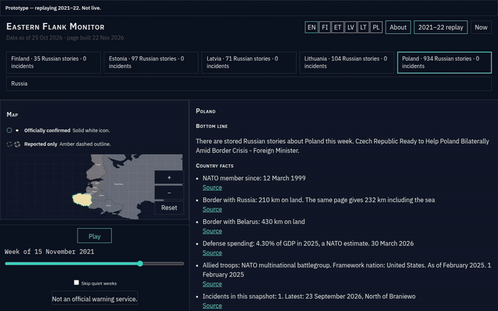

# Eastern Flank Monitor

A briefing room for military tension on NATO's eastern flank — watching Russia's side.

## Highlights

- 79,291 GDELT files were stream-filtered. The kept database is 3.8 GB on disk, about 4 GB.
- The headline classifier was checked against human labels: 93.3% agreement, kappa 0.86, on the adjudicated batch.
- The backtest rules were written down and tagged before scoring. Test A passed. Test B failed. Both results are kept.
- Cost control is strict: a calibration run first, a real-charge cap, and a stop before the next batch. The ledger records about $4.69.
- The page is in six languages. Browser self-tests cover the map, the briefing, and the poll.

**Tech stack:** Python 3.11, SQLite, a static HTML and JavaScript page, and Playwright for the self-tests. LLM APIs: grok-build-0.1 (classifier), Claude Sonnet (judge), with real-charge caps.

## What it is

A local prototype. It reads public Russian coverage of Finland, Estonia, Latvia, Lithuania, and Poland, and shows a calm picture. It does not collect or display Finnish, Baltic, Polish, or NATO force locations.

Two modes:

1. Replay. Stored weeks from 4 January 2021 through 28 February 2022. No hindsight. No API calls.
2. Now. A frozen snapshot, 3 August through 25 October 2026. Attention and incidents only. The full tension level is not computed for Now.

It is not an official warning service. It is not a live siren. In a crisis, follow your national authorities.

Live monitoring is off. Demo mode makes no API calls.

## Features

1. Six country tabs: Finland, Estonia, Latvia, Lithuania, Poland, Russia. One tab is always selected.
2. A fixed briefing, in this order: bottom line, what happened, what officials said, what Russian media says, what regional media says.
3. Official items carry a side label: Russian official, or regional or Western official.
4. A repeated story is one item. The line lists every outlet.
5. A country fact card. Each fact has a dated source link. A fact with no dated page is left out.
6. The Russia tab: Inside Russia, the ruble and the key rate, a Russia fact card, and a Levada poll. Now shows the 16 June 2026 release. Replay keeps the 2021 poll.
7. An incident map. The outlines are Natural Earth, public domain, stored in the project. Confirmed is a solid white icon on a dark circle. Reported is an amber dashed outline. Hover or tap shows one card. A click opens the same item in the briefing. Icons stay the same size when you zoom. The map shows the selected week and the four weeks before it.
8. English is the source language. A Russian line is shown only with an English line. The English line is first.
9. The interface is in six languages: English, Finnish, Estonian, Latvian, Lithuanian, and Polish.
10. An About panel. Method notes live there, not in the briefing.

## How it works

Four layers, from SPEC.md:

1. Capability. Can Russia do it?
2. Intent. Are they preparing the story?
3. Opportunity. Is the window open?
4. Hybrid. How hot is the grey zone?

The two-witness rule is the main guard against a false alarm. The overall level stays at Watchful until two or more layers are Elevated at the same time. Hybrid alone, or Opportunity alone, cannot raise it. An empty layer is not a second witness. It is also not zero. Serious and Critical need a human confirmation before they are shown as those levels. Unconfirmed, they stay Elevated, with the proposal named.

A row counts for a week only if its source date is on or before the last day of that week.

The comparisons used on the About page, and only those, are in `docs/explainers.md`. The app is a weather station, not a siren. The backtest is a smoke detector: Ukraine is the fire, the eastern flank is burnt toast. One witness is not enough. Silence is not calm.

## Results, told straight

The rules were written down before the scoring run. The stored week table was not rewritten after the result.

Test A passed, on a lenient bar. The bar asked only whether Ukraine's shown level reached Elevated before 24 February 2022. It did, on the week of 19 April 2021. It did not ask for a confirmed Serious or Critical alarm. No Serious or Critical level was confirmed. Details: `docs/backtest-report.md`.

Test B failed by the sealed rules. On the week of 7 February 2022 the eastern flank proposed Serious. Intent was 2. Capability was 2. Opportunity was 1.5, and the registered rule rounded 1.5 to 2. Three layers at Elevated made the proposal Serious. It was shown as Elevated, with the proposal named, not as Serious. No war followed in Finland, Estonia, Latvia, Lithuania, or Poland. That is the toast check failing.

Later checks are post-hoc. They are not the result. Of 63 combinations, 52 pass Test B and 11 still fail. Only one rule was adopted for the live app: do not round a layer average up. Tag `live-rules-v1`. It is not applied to the stored table.

Headline validation is in `docs/validation-report.md`. On the adjudicated batch, both checked models agreed with the human label on 14 of 15 relevant headlines (93.3%, kappa 0.86). A later wording check on those same items scored 100%. That check is not independent. The hostile class in that audit is 4 headlines, so the 85% bar is thin. The pipeline classifier is grok-build-0.1. The pipeline judge is Sonnet 5.5. Opus stays in config as an optional reference and is not called.

## What did not work

A weekly per-country consumer screen was the hard part. The stored data is thin at country level. The main screen went through many design rounds. In October 2026 it was judged not informative for an average user. The lesson is in `docs/protocols.md`: show a mockup and get a verdict before building the next screen. This release is a portfolio prototype, not a finished public product.

## Budget

Figures are the recorded runs in `docs/budget.md`. They are not a live account balance.

1. xAI, from console readings: $0.72 on a 20-batch calibration, then $3.54 on the scoring finish. Recorded xAI total: $4.26.
2. Anthropic, from usage tokens times published rates. The console was not opened. Lithuanian translation: $0.087150. Finnish, Estonian, Latvian, and Polish: $0.342260. Recorded Anthropic total: $0.43.
3. Recorded total across those runs: $4.69.

Lessons:

1. Hidden reasoning tokens made the real xAI charge about 3.2 times the token tracker ($0.72 on the console, $0.22 in the tracker). A small calibration run comes first.
2. An automatic recharge charged the card once. Auto-reload stays off on every provider.
3. A real-charge cap is checked after each batch. The next batch does not start once the cap is reached. The scoring cap was $4.70. That run cost $3.54.
4. Translation was measured on one language before the other four were called. The four-language run stayed under its $0.45 cap.

## Data sources and limits

Details and dates are in `docs/sources.md`.

1. GDELT raw files were stream-filtered for 2021–22. The document API returned HTTP 429 and is not used.
2. TASS English works. TASS Russian failed an early check, then a later collector run saved it. The live feed has no archive, so 2021–22 still comes from GDELT.
3. The RIA live feed is disabled. The domain does not resolve on this network. That is treated as a sanctions block, not a short fault. RIA is covered through GDELT. The block was not bypassed.
4. The Russian foreign ministry feed is disabled. The page was not a feed. Those statements are covered through TASS and GDELT.
5. The Levada friends-and-enemies page was reachable. Now uses the 16 June 2026 release. Replay keeps the 2021 poll.
6. Bank of Russia pages for the ruble and the key rate answered for the 2026 window.
7. Russian navigation warnings are taken from the Swedish Baltic page where that page carries them. Allied notices on that page are not stored.
8. GPS interference data has no license for public use and no coverage before 14 February 2022. It is not used.
9. Country facts stay only where a dated page was opened. Capital-to-border distance is left out. Finland has no allied-troops line. Poland has no conscription line. Finland has no overall share on the May 2026 Levada page, so that bar says not listed.
10. The Now incident log has 11 incidents. Dated GPS jamming, and new cable or pipeline damage, were not found.

## How to run locally

1. Clone this repository and open that folder.
2. Leave `live_monitoring: off` in `config/app.yaml`.
3. `python3 -m http.server 8080 --bind 127.0.0.1`
4. Open `http://127.0.0.1:8080/frontend/`
5. Demo mode does not need an API key. Do not start a paid run, or the finished 2021–22 download, from this page.

The daily collector unit does not use a hard-coded home path. See `DEPLOY.md` for `EFM_ROOT`.

Self-tests live in `tests/`. They use a local browser. They make no API calls.

## Repo map

1. `SPEC.md` — what we build. Source of truth.
2. `STATE.md` — where we stopped.
3. `AGENTS.md` — project rules.
4. `config/` — weights, budgets, the frozen Now window.
5. `frontend/` — the local page. UI text is in `frontend/i18n/`.
6. `pipeline/` — fetch, score, and model calls. Paid calls stay off while live monitoring is off.
7. `scripts/` — status, Now build, collectors.
8. `manual/` — dated analyst inputs.
9. `tests/` — self-tests.
10. `docs/` — decisions, tasks, reports, and the sources for this page.
11. `data/` — local files, gitignored. Do not load the backtest database all at once.

## Screenshots

English. Latvia, week of 10 August 2026, hover on Balvi. The icon is officially confirmed.

Lithuanian. Latvia, week of 14 September 2026.

## Data and licenses

1. The code in this repository is under the MIT license. See `LICENSE`.
2. GDELT's about page says its datasets may be used without a fee for academic, commercial, or governmental use. The raw files are not in this repository. See `https://www.gdeltproject.org/about.html`.
3. News stories and official pages are linked. This repository does not redistribute the full articles. A short stored line is a quotation for the briefing, with a link to the source page.
4. The map outlines are Natural Earth, public domain, stored in the project.
5. `data/` is listed in `.gitignore`. It is never committed. Do not add raw downloads, databases, or keys.

## Disclaimer

Built only from publicly available sources: open datasets (GDELT), public news feeds and official pages. Collected politely and automatically, without bypassing access blocks, logins or paywalls, and respecting site terms. Third-party trackers were used only to discover incidents; every item links to its source. Not an official warning service. In a crisis, follow your national authorities.

This is the same text as the About panel. It has not had a legal review. Do not publish it as a public site until that review is done.
